# Corne ZMK Config

ZMK configuration for a Corne split keyboard on `nice_nano_v2`. Mirrors the
[Sofle config](https://github.com/pltanton/sofle-nicenano-oled) on 42 keys.

## Keymap Preview

This preview is generated from [`config/corne.keymap`](config/corne.keymap) and committed to [`keymap-drawer/corne.svg`](keymap-drawer/corne.svg).

